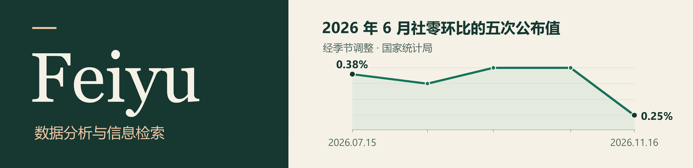

你好，我是 **Feiyu**，在昆士兰大学读书。这里收录了我学习数据分析、搜索和推荐系统时用到的三个项目。前两个可以直接在浏览器里试。

### 社零月报修订查询器

如果在 2026 年 10 月 20 日写月报，6 月社会消费品零售总额的季调环比该填 **0.40%**。11 月 16 日再查，同一个月已经修订为 **0.25%**。在演示里选「2026 年 6 月」，就能逐期查看数值和公报原文。

[打开交互演示](https://tfy20030726-spec.github.io/china-stats-vintages/) · [查看数据和代码](https://github.com/tfy20030726-spec/china-stats-vintages)

### VS Code 重复工单回放

有人报告「侧边栏宽度又被重置了」。只看标题，在当时已有的工单里按重合词数搜索，原单排第 **35**。用 BM25 搜索，原单排第 **2**。演示收录了 13 个有维护者判重记录的案例，也可以看到换了算法后排名下降的例子。

[回放一次搜索](https://tfy20030726-spec.github.io/issue-replay-search/) · [查看检索方法和评测](https://github.com/tfy20030726-spec/issue-replay-search)

### 电影推荐实验

在 MovieLens 的 6,035 名测试用户上，加入 LightGBM 重排后，推荐覆盖的电影从 **42.78%** 增至 **47.12%**，前十名召回率从 **7.01%** 变为 **6.74%**。仓库里保留了这两组结果，以及召回率差值的置信区间。

[阅读实验报告](https://github.com/tfy20030726-spec/movie-recommendation-system/blob/main/reports/reranker_metrics.json) · [查看推荐流程](https://github.com/tfy20030726-spec/movie-recommendation-system)
